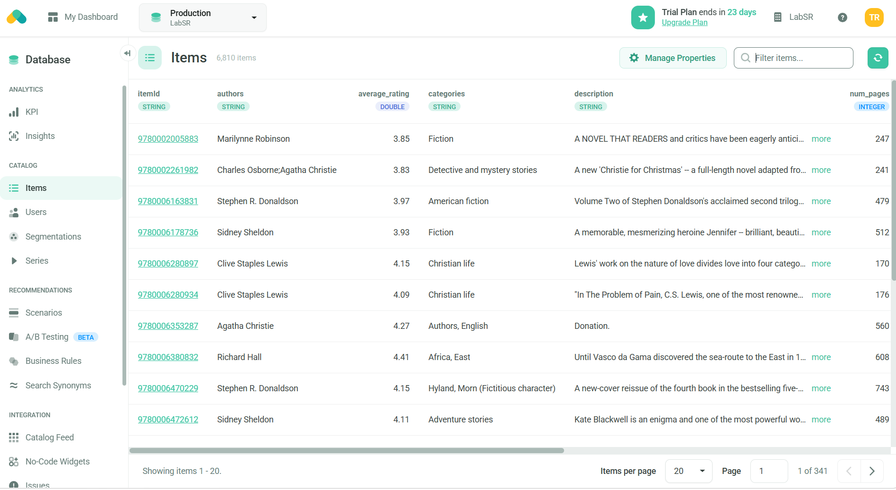

# Laborator 3: Recombee - trimiterea item-urilor în catalog

Continuarea [Laboratorului 2](../lab02/): catalogul Recombee, în care proprietățile au fost deja definite, este populat cu cărțile din dataset.

## Dataset

- **Fișier:** [`books.csv`](books.csv), același dataset ca la Laboratorul 2
- **Sursă:** [Kaggle – 7k Books with Metadata](https://www.kaggle.com/datasets/dylanjcastillo/7k-books-with-metadata)
- **Număr de item-uri:** 6810 cărți

## Maparea datelor

Coloana `isbn13` este ID-ul unic al fiecărei cărți și este trimisă ca `itemId` în Recombee. Restul coloanelor sunt trimise ca valori ale proprietăților definite la Laboratorul 2:

| Coloană CSV | Proprietate Recombee | Tip |
| --- | --- | --- |
| `isbn13` | `itemId` | ID item |
| `title` | `title` | `string` |
| `subtitle` | `subtitle` | `string` |
| `authors` | `authors` | `string` |
| `categories` | `categories` | `string` |
| `description` | `description` | `string` |
| `thumbnail` | `thumbnail` | `image` |
| `published_year` | `published_year` | `int` |
| `average_rating` | `average_rating` | `double` |
| `num_pages` | `num_pages` | `int` |
| `ratings_count` | `ratings_count` | `int` |

Valorile lipsă din CSV sunt trimise ca `null`. Coloanele întregi, citite de pandas ca numere zecimale (ex.: `247.0`) din cauza valorilor lipsă, sunt convertite la `int` înainte de trimitere.

## Trimiterea item-urilor

Scriptul [`recombee_items.py`](recombee_items.py) parcurge rândurile din CSV și creează pentru fiecare carte un request `SetItemValues` cu `cascade_create=True`, care creează item-ul dacă nu există.

Pentru eficiență, request-urile sunt grupate în loturi de câte 100 și trimise printr-un singur request `Batch`. Cele 6810 cărți se trimit astfel în 69 de request-uri HTTP, în loc de 6810.

### Rulare

```powershell
pip install recombee-api-client pandas

# credențialele din Recombee Admin UI -> Settings -> API Logins
$env:RECOMBEE_DB = "numele-bazei-de-date"
$env:RECOMBEE_TOKEN = "private-token"
$env:RECOMBEE_REGION = "eu-west"

python recombee_items.py
```

## Rezultat

Datele au fost încărcate cu succes în Recombee: catalogul conține **6810 item-uri**, cu proprietățile completate.


